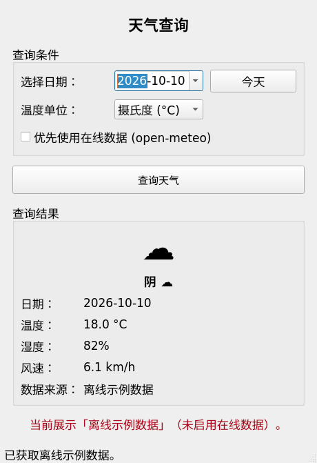
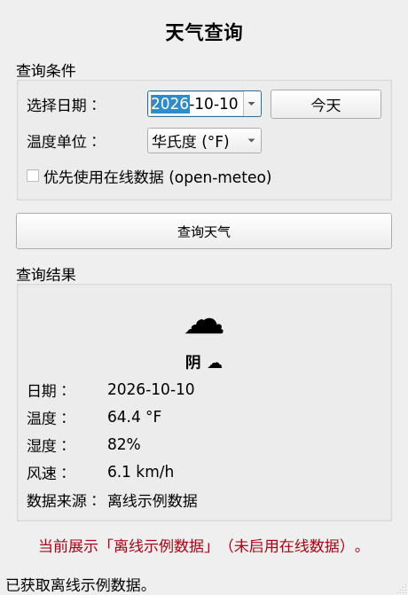
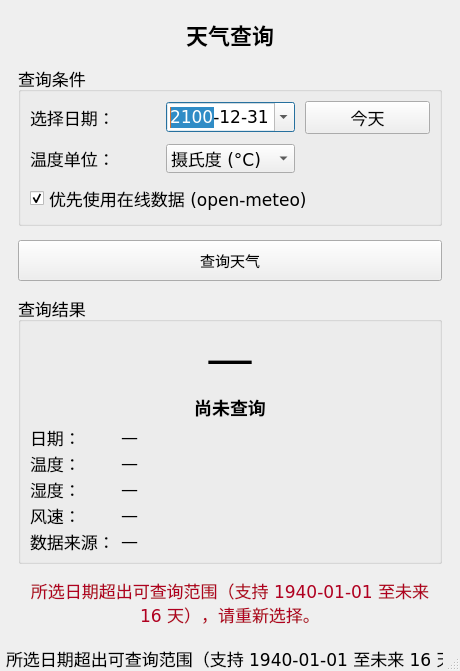

# Agent Team 协作开发实践 · 天气查询桌面应用

> **软件工程课程 · 第四讲《软件过程模型》作业**
> 用一支 **Agent 团队**（主控 + CodeWriter + TestEngineer + CodeReviewer）协作开发一个 PyQt5 桌面应用，
> 并完整记录「开发过程 / 发现的问题 / 总结的经验」。

**测试：154 / 154 通过** · **源码 17 文件 / 980 行** · **2 轮修复迭代** · **评审 17 问题**

---

## 这是什么

一个「选定日期 → 查看该日天气」的 PyQt5 桌面应用，
但它真正的看点是**开发过程本身**：不是让一个「全能 AI」包办，而是按讲义要求组建分工明确的 Agent 团队，
走完 **写码 → 评审 → 测试 → 修复 → 复测** 的完整迭代闭环。

| 角色 | 定位 | 核心规则 | 工具权限 |
|---|---|---|---|
| **主控** | 调度者 | 只编排、按固定工作流推进 | — |
| **CodeWriter** | 开发工程师 | 只写业务代码、不写测试、不执行测试 | 文件读写 / 搜索 / 终端 |
| **TestEngineer** | 测试工程师 | 基于源码写测试、跑测试、回传 bug 清单 | 读文件 / 执行测试 / 读日志 |
| **CodeReviewer** | 评审专家 | 只读代码做静态审查，标记 高/中/低 风险 | 只读文件 / 静态分析 |

> 讲义示例使用 TRAE IDE 的 SOLO Agent；本项目在 Qoder 中**复现同一套角色/权限/工作流**（已在博客中如实说明）。

## 目录结构

```
├── PLAN.md                    # 实施计划
├── SPEC.md                    # 需求规约 + 验收标准
├── 迭代记录.md                 # Agent Team 全流程记录
├── 博客-Agent团队开发实践.md    # 博客成稿（开发过程 / 问题 / 经验）
├── agent-team/                # 4 份角色提示词（可复现）
├── workspace/                 # 程序源码 + tests/（154 用例）
│   ├── app.py                 # 入口
│   ├── weather_app/           # core / providers / services / ui
│   ├── tests/                 # pytest 测试
│   └── requirements.txt
├── reports/                   # 开发说明 / 评审报告 / 测试报告 / bug清单 / 修复说明
└── shots/                     # 运行截图
```

## 快速开始

```bash
pip install -r workspace/requirements.txt    # PyQt5、requests

cd workspace
python app.py                                # 运行程序
QT_QPA_PLATFORM=offscreen python -m pytest tests/ -v   # 运行 154 个测试
```

## 运行截图

| 选定日期查询（摄氏） | 切换华氏度（不重新请求） | 超范围日期友好提示 |
|---|---|---|
|  |  |  |

## 交付物

- **源码**：`workspace/`（分层：core 纯逻辑 / providers 数据源 / services 组合降级 / ui 界面）
- **测试代码**：`workspace/tests/`，154 个用例（全程 mock，不联网）
- **评审报告**：`reports/评审报告.md`（17 个问题：高 1 / 中 5 / 低 11）
- **测试报告**：`reports/测试报告.md`
- **bug 清单**：`reports/bug清单.md`（7 个 bug，全部已修复）
- **博客**：`博客-Agent团队开发实践.md`

## 过程中解决的问题（节选）

- **B01** 畸形响应抛 `AttributeError` 穿透服务层，破坏「失败必降级」契约 → 解析层统一归一化为业务异常
- **B02** 湿度/风速缺失静默回填 0，产生「在线数据」假数据 → 缺失即抛异常、触发降级
- **H1（高风险）** 同步网络请求阻塞 GUI 主线程 → 新增 `ui/query_runner.py` 执行器抽象，
  查询移入后台 `QThread`，`WeatherService` 保持同步（核心好测）

## 结论

> **角色边界＝质量边界**：让写代码的人不写测试、让评审的人只读代码，问题才藏不住。
> 静态评审与动态测试两条独立通道相互印证，最终 154 个用例全绿。

详见 [`博客-Agent团队开发实践.md`](博客-Agent团队开发实践.md) 与 [`迭代记录.md`](迭代记录.md)。
